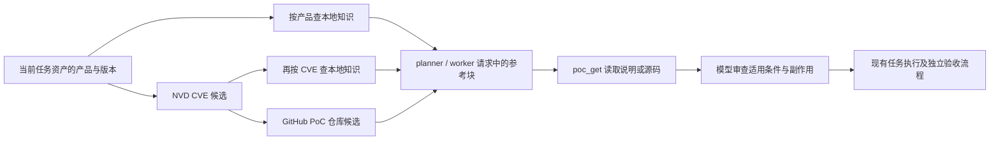

# 知识库与公开 PoC 发现

本批复用 ARTEX 的 PostgreSQL、工具绑定、任务上下文、资源保护、出口敏感信息检查及目标验收流程。没有额外向量库、后台爬虫、自动执行器或 Friend 私有数据库迁移。

## 使用

系统 → 知识库（`/system/knowledge/`）提供本地检索、公开 CVE 查询、PoC 仓库搜索、说明/源码文本阅读、草稿编辑和小批 JSON 导入。导入每批 1–20 条，必须有 title、content、source_ref，外部 verified 标记不会导入。默认草稿；人工将状态改为“允许检索”后才作为 agent 参考。允许检索不代表独立验证通过。

原生工具：

| 工具 | 作用 |
| --- | --- |
| kb_search / kb_get | 检索摘要、读取原文与来源/哈希；只读启用且未过期的全局或当前任务资料 |
| kb_add | 记录当前有效任务的私有草稿，不能自行启用或设置 verified |
| cve_search | 按公开产品名/精确 CVE 查询 NVD，保守标记版本候选、版本不匹配或未知 |
| poc_search | 按精确 CVE 搜索 GitHub 公开仓库，所有结果为未验证候选 |
| poc_get | 读取该 CVE 有效候选中的仓库 README 或指定相对路径文本，保留来源与 blob 标识 |

可以在工具页禁用或解除 agent 绑定。新工具在工具目录缺失/读取失败时不放行；自动预检只使用本轮最终实际可用的工具。

`poc_get` 同时返回 `review`：原文是否提及当前 CVE、下载/动态执行、进程调用、密钥路径、删除/持久化和编码转换等字面提示，以及固定待核对项。状态始终为 `needs_review`，这些提示不是代码审计结论或安全许可。原文只提及其他 CVE 时提示检查候选归属；没有提及任何 CVE 时保留未知。

## 自动流程

planner 派发前和 worker 启动前运行有界预检：只读当前任务关联资产；worker 只读当前意图锚定的资产。每轮最多 2 个产品提示、1 次 CVE 查询、1 个 CVE 的 PoC 搜索，整体 12 秒预算，注入 JSON 最多 12KB。没有产品/版本时不编造指纹。任务已暂停、排队、结束或删除时不做自动查询；终局收尾不查。没有匹配结果、限流或超时继续原有流程，不认定不存在漏洞。

产品查询最多读取 NVD 首尾各 5 条的两个窗口，去重后优先返回版本候选，最多 5 条，保留来源总数/窗口/partial。这不是完整 CVE 库扫描，也不保证覆盖全部适用漏洞。具体 CVE 查询只查精确编号。CPE 范围只辅助筛选，不等于满足全部 AND 配置、功能、部署、补丁回移条件；非纯数字版本保守记未知。

`poc_get` 读取由模型选择。发现仓库、读到源码、实际触发漏洞、最终影响和目标达成分别处理；本批不会因知识命中创建 finding 或完成目标。模型调用 PoC 阅读工具的集成测试使用假模型与合成资料，真实模型尚未验收。

## 来源、隐私和资源

- 公开网络请求固定到 NVD API / GitHub API，不跟随重定向；不接受任意目标 URL，不附平台凭据或 Cookie。产品/CVE/仓库参数经过校验与现有敏感指纹检查。公开产品名仍需正确标注，形状校验不能识别所有企业内部代号。
- GitHub 搜索每次最多 5 个仓库；读取最多 48KiB UTF-8 单文件，拒绝越界路径。正文是资料，不是系统指令；返回 blob 标识是来源记录，不代表作者可信或本地完成签名验证。
- 无自动安装、执行 PoC 的动作。后续执行仍进入既有任务工具、范围与权限流程。
- 缓存 24 小时，写入时最多清理 100 条过期缓存。公开客户端全局最多 1 个在途请求，NVD/仓库搜索 6 秒间隔、源码读取 1 秒间隔；GitHub 共享 55 次/小时本地预算，并遵守服务端冷却，无自动重试。资源保护开关沿用系统设置。
- 知识单条正文最多 32KiB；任务笔记不会自动变全局知识。删除任务时其私有知识按外键级联删除；公共人工知识保留，任务快照恢复不包含本批私有知识。调用记录只留元数据/哈希，不留原始目标或正文，目前无自动清理调用记录的策略。
- 仅预置 4 条原创通用参考。没有导入朋友包的 448 条私有资料、历史任务、证书、默认放行规则，也没有图片所称的 19 万条语料。
- PostgreSQL simple 全文索引加标题/摘要子串匹配；没有大规模语料性能或中文分词基准。暂不引入向量检索，避免本地内存负担。

## 如何判断真的调用

知识库页面显示最近 40 条记录：`prepared` 是预检参考块已生成；`model_request` 是 provider 实际收到的消息中包含完整同一块（同 SHA256），不证明模型遵循或服务端成功响应；`returned` 是工具结果已返回；`failed` 是工具失败。普通工具调用账本还保留调用 ID。知识账本按任务/意图/角色归属，目前不含直接 call_id 字段。

可用入口、记录和测试共同验收；不能仅凭工具出现在列表或模型声称“调用了”判定有效。检索资料不能替代独立漏洞证据与目标验收。

接口依据：[NVD CVE API](https://nvd.nist.gov/developers/vulnerabilities)、[GitHub Search API](https://docs.github.com/en/rest/search/search)、[GitHub REST 配额](https://docs.github.com/en/rest/using-the-rest-api/rate-limits-for-the-rest-api)。服务端配额可能变化，客户端收到限流会退回本地资料/缓存。
